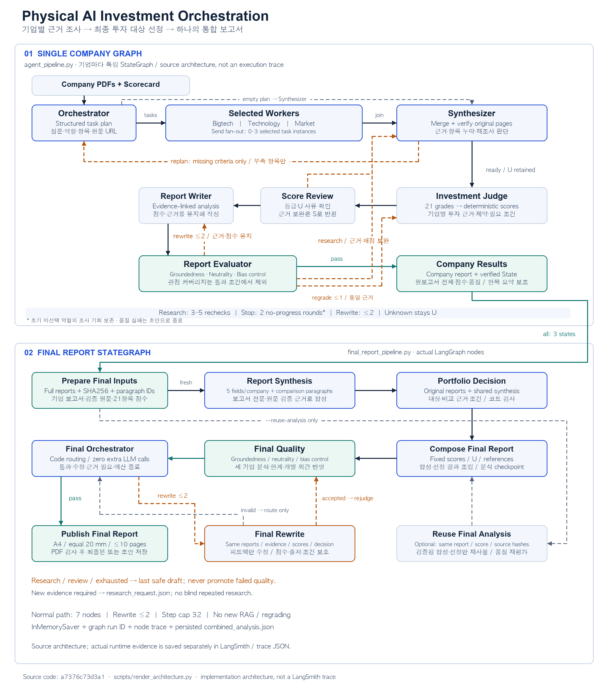

# Subject

MOTOMIND·ROBROS·Figure AI의 제조·물류용 휴머노이드 사업화 가능성을 **Orchestrator-Workers**로 평가하고, 기업별 보고서·검증 근거를 종합해 **최대 10쪽의 최종 투자 보고서 한 파일**을 코드로 생성한다. 기존 RAG의 PDF 검색·원문 검증·21항목 평가표를 재사용한다.

## Overview

- **Objective:** 세 기업을 동일 기준으로 비교하고 최종 투자 대상·이유·필수조건을 제시한다.
- **Pattern:** Orchestrator-Workers — 평가항목별 부족한 질문을 계획하고 전문 워커에 병렬 배분한 뒤 검증된 결과를 합류시킨다.
- **동적 처리:** 필요한 0~3개 역할만 선택하고 완료된 평가항목은 재조사하지 않는다. U 자체는 반복 사유가 아니다. 표현·채점·조사 결함을 구분해 필요한 단계로만 피드백한다.

선택 이유는 **보고서의 근거 연결과 품질 피드백을 명시적으로 제어하기 위해서**다. Supervisor도 같은 기능을 구현할 수 있다. 본 과제는 구조화된 계획→병렬 조사→검증 합류가 적합하다고 판단했다. 본문 결함은 같은 근거로 수정하고 실제 조사 미완료만 워커로 보내 불필요한 호출을 줄이도록 설계했다. 패턴 간 비용 우위는 측정하지 않았다.

## Selected Technologies

- **SW:** 로봇 인지·제어 AI와 VLA — 작업 성능·일반화·학습 데이터 자산을 평가한다.
- **HW:** 휴머노이드 플랫폼 — 현장 안정성·양산·정비·설비 연동을 평가한다.

## Features

- **원문 회수:** 원천 PDF 22개·106쪽 중 대상 기업의 전체 페이지와 COMMON 검색 결과, 등록 원문 URL을 검토한다. 워커가 선택한 줄 구간으로 코드가 실제 인용을 만들고 페이지별 검토·제외·오류를 기록한다.
- **고정 평가표:** [설계 PDF](evaluation/physical_ai_investment_design.pdf) 2~3쪽의 6영역·21항목·100점. 등급 0~4 또는 U, `점수 = 배점 × 등급 ÷ 4`. U를 0점으로 채우거나 확인 배점만으로 재환산하지 않는다.
- **확증 편향 통제:** 회사 발표와 독립 확인, 목표와 달성, 계약 목적과 실제 배치, 납품과 유상 매출을 구분한다. 불리한 정보·미확인·반증을 보존한다.
- **기업 보고서 전달:** `state.final_report` 전문·문단·SHA256·21항목 점수·검증 원문을 최종 종합·선정 노드에 전달한다. 내보낸 Markdown과 State가 다르면 중단하며 실제 입력은 `combined_report_inputs.json`에 저장한다.
- **사실 보존:** U여도 TAS·Master Arm·데이터 플랫폼·Index·성능 목표·고장 정보를 본문에 남긴다. 최종 Judge는 원기업 분석·한계·의견과 핵심 사실의 실제 문단·발췌·원문 ID 및 의미 보존을 함께 검사한다.
- **보고서 품질:** **Hybrid** — 코드의 점수·인용·범위 검사와 원문 기반 LLM Judge로 Groundedness·중립성·편향 통제를 평가한다. **관점 커버리지는 제외**한다. 실제 결함은 문단별 `findings`, 자료 부족은 `data_gaps`로 구분한다.
- **피드백:** 본문 오류→해당 구역 Writer(최대 2회), 채점 오류→Judge(최대 1회), 조사 미완료→해당 워커. 완료된 항목·결함 없는 본문 구역을 보존하고 통과하면 즉시 종료한다.
- **최종 투자 보고서:** 합성→투자 선정→조립→품질→필요한 수정→PDF를 모두 최종 StateGraph에서 실행한다. 총점 자동 선택을 금지하고 근거·위험·필수조건으로 선정한다. A4·상하좌우 20mm·전체 최대 10쪽을 검사하며 미달은 초안으로 보존한다.

세부 입력 계약과 실패·복구 방식은 [입력](docs/final_report_inputs.md)·[최종 그래프](docs/final_report_graph.md)·[최신 원문 감사](docs/evidence_flow_fix.md)에 기록했다.

## Tech Stack

| 구분 | 현재 설정 / 구현 |
|---|---|
| Framework | LangGraph `StateGraph`, `Send`, 조건 분기 |
| LLM / 계획 | `gpt-4.1-mini` |
| LLM / 워커·기업 작성·검증·채점 | `gpt-4.1` |
| LLM / 최종 종합·선정·수정·Judge | `gpt-5.4` |
| Retrieval | NumPy dense 검색·기업/COMMON 필터·디스크 인덱스; Hit Rate@K·MRR 미측정 |
| Embedding | 오픈소스 `BAAI/bge-m3` / sentence-transformers |
| PDF | pypdf·pdfplumber·ReportLab·한글 폰트 임베딩 |
| Trace / Checkpoint | LangSmith + 로컬 JSON / `InMemorySaver` |

역할별 모델은 [.env.example](.env.example)에서 변경한다. 모델 변경에 따른 품질·비용 개선률은 미측정이다.

## Agents

| 구성 | 책임 |
|---|---|
| Orchestrator | 항목별 부족 사유로 `{id, worker, query, criteria, urls}` 계획 |
| Bigtech Worker | 지분 투자·고객 계약·납품·유상 매출·재구매 |
| Technology Worker | 팀·성능·안전·양산·학습 및 기술 자산 |
| Market Worker | 고객 문제·시장·경쟁 가치·전환 장벽 |
| Synthesizer | 병렬 결과 병합·원문 검증·완료/미완료·무진전 판정 |
| Investment Judge / Case | 21항목 등급·점수 검증·개별 투자 의견·조건 |
| Writer / Evaluator | 기업 보고서 작성·원문 품질 평가·필요 단계 피드백 |
| Report Synthesis | 실제 기업 보고서 전체의 분석·한계·의견 종합 |
| Portfolio Decision | 같은 원보고서·합성·근거로 최종 대상·비교 이유·조건 선정 |
| Final Quality / Orchestrator / Rewrite | 내용·반영 검사, 통과·수정·초안 종료 분기 |
| Compose / Publish | 고정 점수표·U·출처 조립, PDF 규격 검사·저장 |

워커 기준 [Bigtech](prompts/workers/bigtech.md)·[Technology](prompts/workers/technology.md)·[Market](prompts/workers/market.md)는 실행 시 실제 로드하고 SHA256을 기록한다. MD만으로 품질을 보장하지 않으며 원문 검사·완료 분기·독립 평가와 함께 사용한다. 워커는 결과만 반환하고 공용 계획·예산을 직접 변경하지 않는다.

## State Schema

| 설계 항목 | 구현 |
|---|---|
| 제어 vs 페이로드 | 계획·route·feedback·예산과 research·investment·report 분리 |
| 관측성 위치 | State에 현재 상태·사유·시도·종료 이유, 외부 JSON/LangSmith에 실행 기록 |
| 지속성 비용 | PDF·벡터는 파일/캐시, 유한 라운드 결과만 누적; 전체 State 바이트 상한은 없음 |
| 상관 | 기업/최종 `trace_id`·graph UUID ↔ checkpoint `thread_id`·외부 trace |
| 재개/복구 | 기업 보고서 단계 복구, 최종 분석 재사용 후 새 품질 평가; PDF만 실패하면 모델 없이 재렌더링 |
| 동시 처리 | `라운드:작업ID` reducer 병합·충돌 검사, 공용 카탈로그는 Synthesizer만 갱신 |
| 종료 보장 | 추가 조사 기본 4회·설정 3~5회, 무진전 2회 중단, 본문 수정 최대 2회; 최종 단계 32/recursion 40 |

`completed`는 조사·품질 통과, `partial`은 U/조사 한계가 남은 품질 통과, `quality_failed`는 초안이다. 수정 예산은 실행 단위다. 프로세스 재시작 후 일반 조사 재개·DB 지속 체크포인트·전체 시간/비용 상한은 추가 구현 대상이다.

## Architecture



소스 구조를 검사해 생성한 구조도이며 실제 실행 trace와 구분한다.

## Directory Structure

```text
app.py / agent_pipeline.py       실행·기업별 StateGraph
final_report_pipeline.py         최종 종합·선정·품질·수정 StateGraph
source_worker.py / task_evidence.py  전체 페이지 검토·실제 인용 추출
criteria_*.py / state_schema.py  항목별 완료·제어 상태·reducer
investment_*.py                  채점·개별 투자 판단
company_report_inputs.py         전문·SHA256·문단·검증 원문 입력
report_synthesis.py / portfolio_decision.py  종합·최종 선정
report_assertions.py / report_language.py   범위 과장·인용 검사
fact_preservation.py / combined_quality.py  핵심 사실 보존·최종 Judge
combined_report.py / report_renderer.py     보고서 조립·A4 출력
rag/ / com_data/                 기존 RAG 모듈·원천 PDF·기업 자료집
prompts/workers/ / evaluation/   워커 기준 MD·평가 기준 PDF·독립 표본
docs/ / scripts/ / tests/        구조·감사·추적 / 실행·패키지 / 회귀 검사
output/submission-live/          최신 검증 보고서·State·점수·trace
output/submission/               제출 ZIP·manifest·SHA256
```

## Usage

```bash
cd minimal-orchestration
python3 -m venv .venv
.venv/bin/python -m pip install -r requirements-rag.txt
cp .env.example .env               # .env가 없을 때만; API 키 입력
.venv/bin/python app.py             # 3기업 조사 → 최종 투자 보고서
# 기존 통과한 기업 결과로 최종 그래프만 실행
.venv/bin/python app.py --combine-reports output/submission-live
# 동일 본문·점수·원문인 저장 분석 재사용; 품질은 새로 평가
.venv/bin/python app.py --combine-reports output/submission-live \
  --reuse-analysis output/submission-live/combined_analysis.json
# API 없는 입력·원문·해시 검사
.venv/bin/python app.py --check-combine-inputs output/submission-live --output-dir output/input-check
```

한 기업은 `--company MOTOMIND`, `--company ROBROS`, `--company "Figure AI"`로 실행한다. `--demo`는 API 없는 구조 시연이다. 첫 실제 실행에는 BGE 모델 다운로드·임베딩이 필요하다. 입력 위치·모델 설정·복구·패키지 명령은 [SUBMISSION.md](SUBMISSION.md)를 따른다.

**최신 실제 검증:** 기업별 품질 3/3 통과, 완료 평가항목 재조사 0건. 최종 보고서는 **Figure AI 조건부 투자·A4 9쪽·동일 20mm 여백**이며, 기업별 점수와 본문 해시를 보존했다. 핵심 3축·분석/한계/의견 반영 증거 9개·핵심 사실 반영 6개를 통과했다. 회귀 검사 **531개 + 하위 테스트 22개 통과**다. 현재의 15개 원문 표본 검증은 전체 사실 회수율·정확성의 보장이 아니다.

[최종 PDF](output/submission-live/final_investment_report.pdf) · [본문](output/submission-live/final_investment_report.md) · [점수·반영·품질 JSON](output/submission-live/final_investment_report.json) · [원문 전달 감사](output/submission-live/evidence_flow_audit.json) · [실행·복구 감사](output/submission-live/final_report.execution_audit.json)

기업별 상세 보고서·A4 한 쪽 요약은 중간 산출물이다. 최종 입력은 한 쪽 요약이 아닌 완성 보고서 전문과 검증 근거다. 최종 선정은 필수조건 충족 전 집행을 유보하며 실제 거래를 자동 실행하지 않는다.

**LangSmith:** `.env`의 `LANGSMITH_TRACING=true`·`LANGSMITH_API_KEY`·`LANGSMITH_PROJECT`로 연결한다. [최신 trace JSON](output/submission-live/final_report.trace.json)의 root는 `01a14365-dc0e-7511-b69d-986555bf9f3c`이다. 마지막 품질 재검증은 재작성 0회이며 이전 수정 3회·시간 초과·규칙 오탐 이력은 감사 기록에 보존했다. [기존 화면 PNG](docs/traces/README.md)는 과거 실행으로 구분한다.

## Contributors

- 이상수 : Source Research, Document Catalog — 기업 자료 조사·원문 수집·문서 카탈로그 관리
- 우강산 : PDF Parsing, Source Management — PDF 파싱·텍스트 추출·원본 페이지 및 출처 연결
- 정지영 : Embedding, Retrieval Agent — 임베딩·기업별 검색·검색 인덱스 및 캐시 관리
- 박소정 : Prompt Engineering, Analysis Agent Design — 빅테크·기술·시장 분석 워커 설계·분석 프롬프트 작성
- 김재혁 : Agent Orchestration, Investment Judge, Report Synthesis — LangGraph 제어·근거 검증·투자 판단·보고서 종합 및 품질 평가

제출 브랜치: [`codex/physical-ai-agent`](https://github.com/fabianskii1/physical-ai-investment-rag/tree/codex/physical-ai-agent). 캠퍼스·분반이 미등록이어서 ZIP은 중립 파일명을 사용한다. 제출 최종 보고서는 **3기업 통합 한 파일·전체 최대 10쪽**이다.
