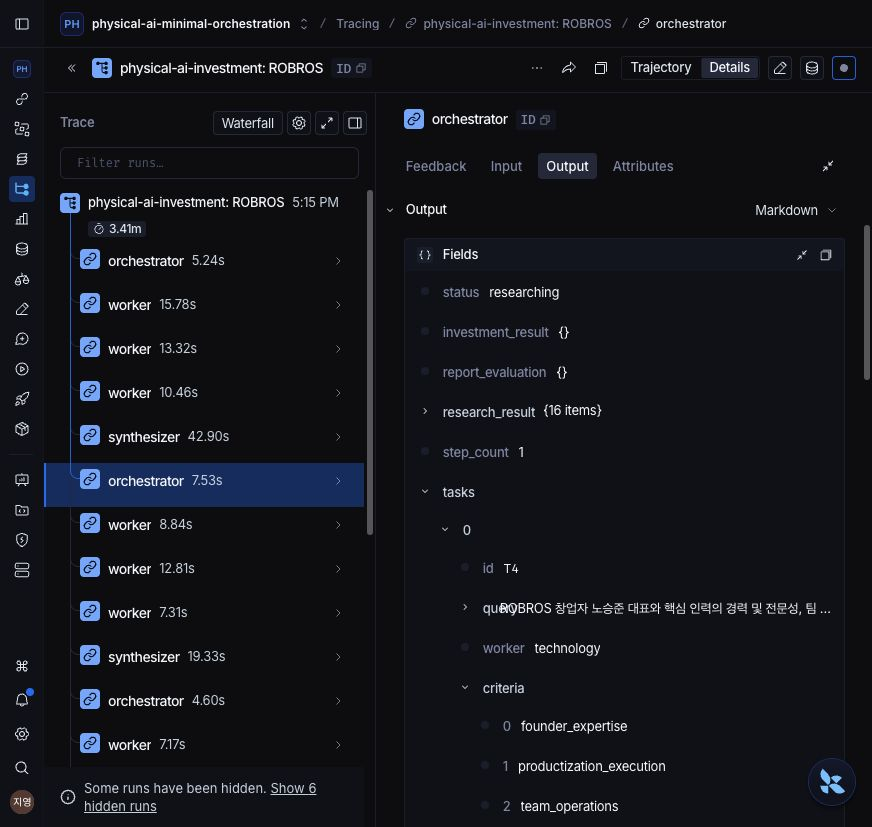
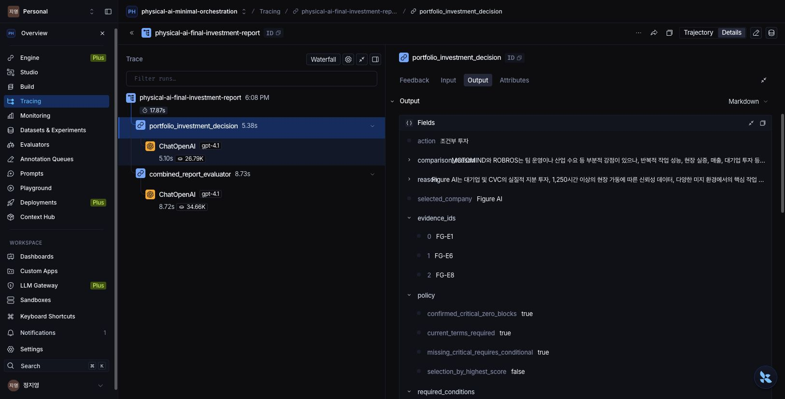
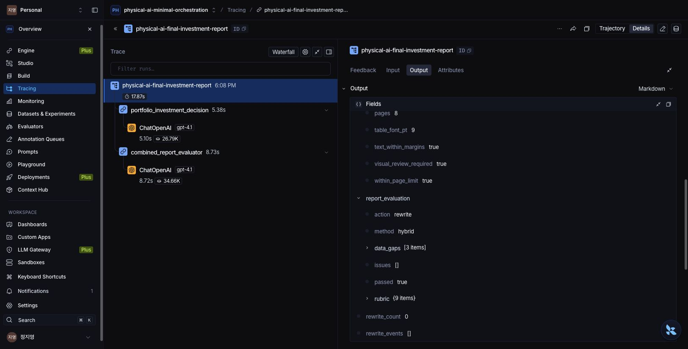
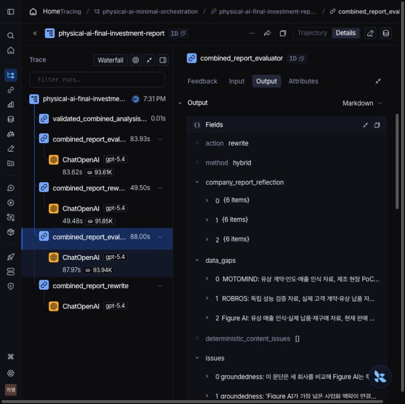
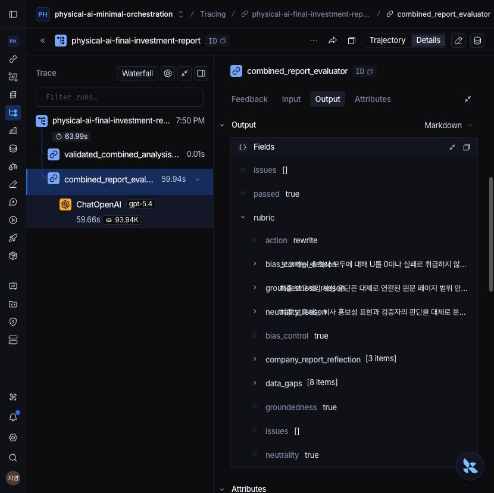

# 실제 LangSmith 캡처 기록

**PNG 1~3은 기업 보고서 합성 단계 추가 전의 실행 기록이다.** 02~03의 8쪽·Figure AI 조건부 선정·품질 통과는 당시 결과이며, 새 합성 코드의 출력·반영 검사·통과를 입증하지 않는다. PNG 04는 실제 중간 실패·수정 루프, PNG 05는 최신 교정 본문의 새 품질 통과다.

## 01 — ROBROS 조사 계획·병렬 워커·재계획

- [LangSmith 원본 실행 화면](https://smith.langchain.com/o/c01772ab-a5d3-4d57-b4bf-cd70e6172036/a/physical-ai-minimal-orchestration/projects/p/4372ac10-81d3-4df7-a361-99ae41aeff48/trace/8c32bdfc-7d13-483b-a173-64c27ca957a8/run/01a13455-787e-7540-ac27-0d1d02b20d60?scroll_to=output&start_time=2026-10-13T08%3A16%3A19.070622Z)
- 프로젝트: `physical-ai-minimal-orchestration`; 실제 ROBROS root run: `8c32bdfc-7d13-483b-a173-64c27ca957a8`.
- 화면에 세 워커 → Synthesizer 합류 → Orchestrator 재계획과 `tasks`·`worker`·`criteria`의 실제 출력이 표시된다.
- 캡처 원본 JPEG 저장 시각: **2026-10-13 08:27:36 UTC**. PNG 포맷 변환 저장 시각: **2026-10-13 08:31:01 UTC** (파일 수정시각 기준).
- CUA가 실제 LangSmith 화면에서 받은 JPEG 바이트를 보관하고 PNG로 포맷만 변환했다. 크롭·화면 재생성·픽셀 편집은 하지 않았다.

이 캡처는 기업별 조사 계획과 동적 재배분의 실행 증거다. 최종 투자 대상 선정은 아래 02의 별도 배치 실행으로 확인한다. [구조 이미지](../architecture.png)는 코드의 아키텍처 설명이며 실행 화면과 구분한다.

## 02 — 최종 투자 대상 선정

- [LangSmith 원본 선정 화면](https://smith.langchain.com/o/c01772ab-a5d3-4d57-b4bf-cd70e6172036/a/physical-ai-minimal-orchestration/projects/p/4372ac10-81d3-4df7-a361-99ae41aeff48/trace/01a13485-2078-7a21-96dd-9e9a0ef15acb/run/01a13485-27b5-7130-99ca-dd0dc9c86a61?start_time=2026-10-13T09%3A08%3A24.117946Z&scroll_to=output)
- 통합 root run: `01a13485-2078-7a21-96dd-9e9a0ef15acb`; 선정 agent run: `01a13485-27b5-7130-99ca-dd0dc9c86a61`.
- 실제 `portfolio_investment_decision` 출력은 **Figure AI / 조건부 투자**, 근거는 `FG-E1`·`FG-E6`·`FG-E8`이다. 화면의 정책은 현재 거래조건 필요, 핵심 부정 사실 차단, 최고 총점 자동선택 금지를 표시한다.
- 같은 실행 트리에 선정 에이전트와 `combined_report_evaluator`의 `gpt-4.1` 호출이 표시된다.
- 캡처 원본 JPEG 저장 시각: **2026-10-13 09:16:40 UTC**. PNG 포맷 변환 저장 시각: **2026-10-13 09:16:48 UTC** (파일 수정시각 기준).
- 실제 UI 캡처의 JPEG→PNG 포맷만 변환했으며 크롭·화면 재생성·픽셀 편집은 하지 않았다.

이 **과거 실행**의 통합 PDF는 **8쪽**이었고 당시 JSON에 `completed`와 핵심 세 축 통과·미확인 실사자료가 기록됐다. `output/submission-live/final_investment_report.*`는 재실행 시 바뀌므로 현재 경로의 파일을 이 캡처의 당시 결과로 간주하지 않는다. 조건부 선정은 필수조건 충족 후 투자한다는 제안이며 즉시 투자 집행을 의미하지 않는다.

## 03 — 통합 품질 통과·PDF 규격

- [LangSmith 원본 통합 결과 화면](https://smith.langchain.com/o/c01772ab-a5d3-4d57-b4bf-cd70e6172036/a/physical-ai-minimal-orchestration/projects/p/4372ac10-81d3-4df7-a361-99ae41aeff48/trace/01a13485-2078-7a21-96dd-9e9a0ef15acb/run/01a13485-2078-7a21-96dd-9e9a0ef15acb?scroll_to=output&start_time=2026-10-13T09%3A08%3A22.264974Z)
- 02와 같은 root run의 실제 Output에 `pages=8`, `within_page_limit=true`, `text_within_margins=true`, `method=hybrid`, `issues=[]`, `passed=true`가 표시된다.
- **이번 실행의 재작성은 0회**다: `rewrite_count=0`, `rewrite_events=[]`. `action=rewrite`는 미달 시 사용할 반환 유형이며 `passed=true`인 이번 실행에서는 재작성 분기를 실행하지 않았다.
- 캡처 원본 JPEG 저장 시각: **2026-10-13 09:18:17 UTC**. PNG 포맷 변환 저장 시각: **2026-10-13 09:18:36 UTC** (파일 수정시각 기준).
- 실제 UI 캡처의 JPEG→PNG 포맷만 변환했으며 크롭·화면 재생성·픽셀 편집은 하지 않았다.

## 04 — 실제 품질 미달·재작성 루프

- [LangSmith 원본 중간 평가 화면](https://smith.langchain.com/o/c01772ab-a5d3-4d57-b4bf-cd70e6172036/projects/p/4372ac10-81d3-4df7-a361-99ae41aeff48/trace/01a134d1-1f8c-7d11-8e37-5cfd9072e416/run/01a134d3-3804-72c1-b1f5-dd44ee80d68a?scroll_to=output&start_time=2026-10-13T10%3A33%3A40.100154Z)
- 실제 v8 root run: `01a134d1-1f8c-7d11-8e37-5cfd9072e416`. 동일 입력 분석 재사용 이후 `combined_report_evaluator`→`combined_report_rewrite`→재평가→두 번째 재작성의 실행 트리가 표시된다.
- 선택된 품질 결과는 `method=hybrid`, `action=rewrite`, 실제 `issues`와 세 기업 반영 판정을 보여 준다. 두 번째 재작성 진행 중의 화면이므로 이 캡처는 **최종 통과·최종 PDF의 증거가 아니다**.
- 캡처 원본 JPEG 저장 시각: **2026-10-13 10:39:04 UTC**. PNG 포맷 변환 저장 시각: **2026-10-13 10:39:18 UTC** (파일 수정시각 기준).
- 실제 UI 캡처의 JPEG→PNG 포맷만 변환했으며 크롭·화면 재생성·픽셀 편집은 하지 않았다.

## 05 — 최신 통합 품질 통과

- [LangSmith 원본 최신 품질 화면](https://smith.langchain.com/o/c01772ab-a5d3-4d57-b4bf-cd70e6172036/a/physical-ai-minimal-orchestration/projects/p/4372ac10-81d3-4df7-a361-99ae41aeff48/trace/01a134e2-45e8-75d3-b50c-b2246ae727ad/run/01a134e2-546f-7362-819a-16dfdac31441?scroll_to=output&start_time=2026-10-13T10%3A50%3A10.415894Z)
- 실제 v10 root run: `01a134e2-45e8-75d3-b50c-b2246ae727ad`; 평가 run: `01a134e2-546f-7362-819a-16dfdac31441`.
- 화면의 실행 트리는 `validated_combined_analysis_reuse`→`combined_report_evaluator` 1회→`gpt-5.4`를 표시한다. 원보고서·점수·검증 원문이 같은 합성·선정은 재사용하고 품질만 새로 판정한 실행이다.
- Output의 `passed=true`, `groundedness=true`, `neutrality=true`, `bias_control=true`, `issues=[]`와 세 기업 반영 판정 목록을 확인한다. `action=rewrite`는 미달 시의 반환 유형이며 이 통과 실행의 재작성은 **0회**다.
- 캡처 시각: **2026-10-13 10:58:55.214378 UTC**. CUA가 실제 LangSmith 화면에서 받은 JPEG를 PNG로 포맷만 변환했으며 크롭·화면 재생성·픽셀 편집은 하지 않았다. 정확한 URL/run/시각은 [캡처 메타데이터](current_captures.json)에 보존한다.

현재 [최종 PDF](../../output/submission-live/final_investment_report.pdf)·[품질 JSON](../../output/submission-live/final_investment_report.json)은 이 v10의 검증 본문을 공식 경로에 보존한 결과다. JSON의 `completed`, 핵심 3축·세 기업 반영 통과, `pages=8`, A4·20mm 여백·쪽 수 상한, `rewrite_count=0`을 확인했다. 8쪽 규격은 JSON/PDF로 검증하며 이 화면에 쪽 수가 표시된 것으로 설명하지 않는다.
